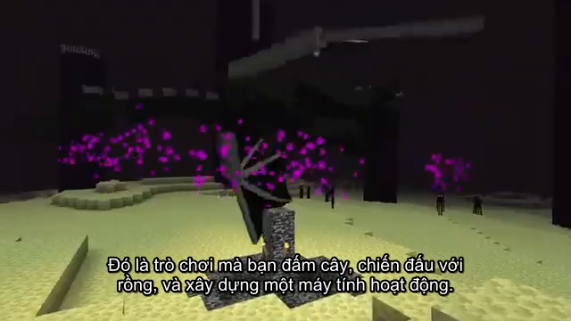

# Báo cáo tuần 6 — Sprint 3: tích hợp và hoàn thiện

Dành cho giảng viên và nhóm 14. Báo cáo trình bày kết quả tích hợp, dữ liệu mẫu, kiểm thử và phiếu lỗi để nộp tuần 6.

**Nhóm:** 14 — Tuần 6, Sprint 3: tích hợp và hoàn thiện.

**Đề tài:** Hệ thống web dịch và chèn phụ đề tiếng Việt cho video tiếng Anh.

**Ngày kiểm chứng được sử dụng:** 14/10/2026.

**Thành viên (nhóm trưởng: Nguyễn Lê Đức Bình):**

| Thành viên | MSSV | Vai trò | Phụ trách |
|---|---|---|---|
| Nguyễn Lê Đức Bình | 23050025 | Nhóm trưởng | Nền tảng, cơ sở dữ liệu, điều phối và tích hợp |
| Đinh Hoàng Phú | 23050002 | Thành viên | Đầu vào video, nhận dạng lời thoại, kiểm vùng mờ và tiến độ |
| Phạm Tuấn Kiệt | 23050046 | Thành viên | Dịch, thuật ngữ, làm mờ và xuất video |

## 1. Mục tiêu

Theo yêu cầu tuần 6, nhóm cần tích hợp toàn bộ hệ thống, bổ sung chức năng nếu cần, hoàn thiện giao diện và chuẩn bị dữ liệu đủ cho một phiên giao dịch. Hoạt động trọng tâm là kiểm thử các chức năng bằng dữ liệu đúng và sai. Sản phẩm nộp gồm phiên bản tích hợp và phiếu lỗi từ mẫu test sai.

Trong dự án này, một phiên giao dịch là một lượt xử lý video: nhận đầu vào → nhận dạng lời thoại → dịch tiếng Việt → kết xuất → kiểm tra kết quả.

Báo cáo sử dụng [báo cáo mục tiêu](BAO_CAO_MUC_TIEU.md), [phiếu lỗi](PHIEU_LOI.md), dữ liệu phien_01/, du_lieu_loi/ và bằng chứng minh_chung/ trong tuần 6. Các tuần trước chỉ được tham khảo về bố cục trình bày.

## 2. Kết quả thực hiện

| Yêu cầu | Kết quả trong hồ sơ tuần 6 | Phần chưa xác nhận |
|---|---|---|
| Tích hợp hệ thống | Đã kiểm HTTP, SQLite, ffmpeg; kiểm riêng GPU, Whisper và NLLB thật | Chưa demo toàn luồng bằng thao tác trình duyệt |
| Chức năng bổ sung nếu có | Không bổ sung chức năng trong đợt này | Đây là mục tùy chọn |
| Làm đẹp và thống nhất giao diện | Có ảnh đầu ra hiển thị phụ đề Việt | Chưa có kiểm chứng mới về bố cục desktop/mobile; ảnh video không chứng minh giao diện ứng dụng |
| Dữ liệu đủ cho một phiên | Đã lưu PHIEN-01 gồm đầu vào, phụ đề, CSDL và đầu ra | Phiên tắt làm mờ; nhánh vùng mờ được kiểm riêng |
| Test một công việc cụ thể | Đã chạy nhận dạng–dịch–xuất video 30 giây bằng model thật | Chưa nghe/xem toàn bộ để đánh giá lời dịch |
| Dữ liệu lỗi và phản hồi | Tám trường hợp sai bị chặn đúng; hai đối chứng qua | Kết quả validator/API không thay thế quan sát giao diện |
| Phiếu lỗi | Có PL-01 đến PL-08, kèm mẫu và phản hồi | Không có tám lỗi phần mềm mới; đây là tám lỗi đầu vào |

**Kết quả chính:** có một phiên xử lý hoàn chỉnh được lưu lại và có bằng chứng kiểm lỗi. Chưa kết luận đạt toàn bộ yêu cầu tuần 6 khi demo và kiểm giao diện còn chưa thực hiện.

## 3. Dữ liệu mẫu cho một phiên hoàn chỉnh

PHIEN-01 sử dụng clip 30 giây trích từ video_2.mp4. Cấu hình gồm Whisper base trên GPU CUDA, NLLB local và tắt làm mờ. Nguồn, cấu hình, thông số và mã băm được ghi trong [manifest](phien_01/manifest.json).

| Dữ liệu | Tệp | Kết quả |
|---|---|---|
| Video đầu vào | [clip.mp4](phien_01/clip.mp4) | Đầu vào đúng của phiên |
| Phụ đề gốc | [sub_goc.srt](phien_01/sub_goc.srt) | 5 câu nhận dạng |
| Phụ đề Việt | [sub_vi.srt](phien_01/sub_vi.srt) | 5 câu, giữ mốc thời gian |
| Phụ đề kết xuất | [sub_vi.ass](phien_01/sub_vi.ass) | Tệp định dạng dùng để vẽ phụ đề |
| CSDL phiên | [s.db](phien_01/s.db) | Dữ liệu thử riêng của phiên |
| Video đầu ra | [ra_vi.mp4](phien_01/ra_vi.mp4) | 640 × 360; 30,071708 giây; có hình và âm thanh |
| Ảnh minh chứng | [khung_phu_de.png](phien_01/khung_phu_de.png) | Có phụ đề Việt tại thời điểm trích ảnh |

Mỗi tệp trong phiên có vai trò riêng trong cùng công việc. Không tính các tệp này thành nhiều phiên thử độc lập. Đã xem một khung hình; chưa nghe/xem toàn video.

## 4. Dữ liệu cho từng nhóm chức năng

Đề bài yêu cầu đủ mẫu cho từng trường hợp; ví dụ năm chức năng cần năm mẫu đúng cùng các mẫu sai. Bảng dưới phân biệt mẫu lưu sẵn với dữ liệu chỉ được bộ test tạo khi chạy.

| Nhóm chức năng | Mẫu đúng hoặc bằng chứng hiện có | Mẫu sai hoặc điều kiện lỗi | Mức sẵn sàng |
|---|---|---|---|
| Nhận dạng lời thoại | clip.mp4 và sub_goc.srt; kiểm Whisper thật | Tệp rỗng, sai định dạng | Có dữ liệu lưu trong tuần 6 |
| Dịch phụ đề | sub_goc.srt → sub_vi.srt; kiểm NLLB thật | Nhánh lỗi dịch được kiểm trong bộ offline | Có cặp đầu vào/đầu ra của phiên |
| Kết xuất video | clip.mp4, sub_vi.ass và ra_vi.mp4 | Bộ offline có kiểm lỗi kết xuất | Có dữ liệu phiên; chưa nghe/xem toàn bộ |
| Vùng mờ | hop_hop_le.json; runtime chờ chọn vùng rồi tiếp tục | Bốn phần tử sai trong hop_loi.json | Có mẫu hình học; phiên model thật không bật làm mờ |
| Lưu trữ và thuật ngữ | s.db; log offline kiểm dữ liệu và trigger lịch sử | co_so_du_lieu_hong.db; xung đột và restart trong runtime | Có CSDL phiên; bộ mẫu thao tác từng chức năng trên web chưa được ghi thành phiên riêng |

Các mẫu lỗi nằm tại du_lieu_loi/. Chưa dùng số test qua để khẳng định mọi chức năng đều đã có mẫu thao tác thủ công đầy đủ. Xem [TEST_CASE.md](TEST_CASE.md) để biết điều kiện và phạm vi từng kiểm.

## 5. Kết quả kiểm thử

| Bộ kiểm đã ghi ngày 14/10/2026 | Chạy | Qua | Lỗi | NOT RUN | Bằng chứng |
|---|---|---|---|---|---|
| Offline | 102 | 102 | 0 | 0 | [offline.txt](minh_chung/offline.txt) |
| Runtime HTTP, SQLite, ffmpeg | 1 | 1 | 0 | 0 | [runtime-results.json](minh_chung/runtime-results.json) |
| GPU và model thật | 6 | 6 | 0 | 0 | [real.txt](minh_chung/real.txt) |
| Chạy lại đầu cuối để lưu PHIEN-01 | 1 | 1 | 0 | 0 | [phien.txt](minh_chung/phien.txt) |
| Mẫu sai và đối chứng | 10 | 10 | 0 | 0 | [mau_loi.json](minh_chung/mau_loi.json) |
| Đo độ phủ, ngưỡng 90% | 1 | 1 | 0 | 0 | [coverage.txt](minh_chung/coverage.txt): 97,0% |
| Demo thao tác web | 0 | 0 | 0 | 1 | Chưa có biên bản |
| Nghe/xem toàn bộ video | 0 | 0 | 0 | 1 | Chưa đánh giá thủ công |
| Kiểm giao diện desktop/mobile | 0 | 0 | 0 | 1 | Chưa có kết quả trong đợt này |

Runtime dùng ASR/dịch giả lập; sáu test thật kiểm GPU, Whisper base/large-v3, NLLB và luồng đầu cuối. Không cộng các dòng thành số test độc lập: PHIEN-01 chạy lại một test thật; độ phủ chạy lại offline.

Đây là tổng hợp bằng chứng đã có trong tuần 6. Lần sửa báo cáo này không chạy lại hệ thống và không tạo kết quả test mới.

## 6. Phiếu lỗi và điều kiện kích hoạt

| Phiếu | Mẫu sai | Phản hồi ghi nhận |
|---|---|---|
| PL-01–PL-04 | Vùng vượt khung, rộng bằng 0, tọa độ boolean, thiếu chiều cao | Bộ kiểm vùng từ chối |
| PL-05 | SRT có câu lỗi | Chế độ chặt từ chối; chế độ bỏ câu lỗi giữ một câu hợp lệ |
| PL-06 | Tệp không phải SQLite | Bộ kiểm bản sao CSDL từ chối |
| PL-07 | Video rỗng | HTTP 400, không để lại tệp tải lên |
| PL-08 | Tệp .txt | HTTP 400, không để lại tệp tải lên |

Chi tiết bước tái hiện, phản hồi và cách sửa dữ liệu nằm trong [PHIEU_LOI.md](PHIEU_LOI.md). Tám trường hợp sai đều được xử lý đúng, nên kết quả kiểm là PASS.

Điều kiện kích hoạt nhánh lỗi khác trigger SQLite. Trigger SQLite tự ghi lịch sử thay đổi dữ liệu; test_trigger_lich_su_moi_duong_ghi có kết quả PASS trong log offline tuần 6. Runtime còn kiểm gửi trùng, phụ đề thay đổi, restart và khóa còn sót sau sự cố.

## 7. Đối chiếu tiêu chí chấm

| Tiêu chí từ ảnh yêu cầu | Điểm tối đa | Bằng chứng và giới hạn |
|---|---|---|
| Hệ thống tích hợp hoàn chỉnh, demo tốt | 3 | Có runtime và video đầu ra thật; demo web chưa thực hiện |
| Hoàn thiện chức năng so với đặc tả ban đầu | 3 | Có kiểm thử chức năng; hồ sơ tuần 6 chưa có đối chiếu đầy đủ từng yêu cầu của đặc tả ban đầu |
| Giao diện nhất quán, đủ dữ liệu mẫu để dùng thử | 2 | Có bộ phiên và mẫu lỗi; chưa kiểm lại giao diện và chưa ghi đủ phiên thủ công cho mọi chức năng |
| Chất lượng kiểm thử lỗi và phản hồi hệ thống | 2 | Có mẫu sai, điều kiện kích hoạt, phản hồi và tám phiếu lỗi |

Không tự chấm điểm thay giảng viên. Những phần thiếu bằng chứng được ghi rõ để nhóm bổ sung khi trình bày.

## 8. Hồ sơ nộp và việc còn lại

Hồ sơ tài liệu gồm báo cáo này, [bộ ca kiểm thử](TEST_CASE.md), [phiếu lỗi](PHIEU_LOI.md), [kịch bản demo](KICH_BAN_DEMO.md), dữ liệu mẫu và bằng chứng trong thư mục tuần 6. Phiên bản tích hợp của ứng dụng phải được nộp kèm theo yêu cầu môn học; riêng các tệp MD không thay thế ứng dụng chạy được.

Trước nghiệm thu, nhóm cần demo trực tiếp, nghe/xem toàn bộ đầu ra, kiểm giao diện và bổ sung đối chiếu từng chức năng với đặc tả. Báo cáo theo thành viên chỉ chia phần trình bày bằng chứng tuần 6; chưa xác nhận ai tự thực hiện từng lượt kiểm.

## 9. Nguồn nội dung

- [BAO_CAO_MUC_TIEU.md](BAO_CAO_MUC_TIEU.md): mục tiêu, phiên mẫu, kết quả và giới hạn.
- [PHIEU_LOI.md](PHIEU_LOI.md): tám mẫu sai và phản hồi.
- [phien_01/manifest.json](phien_01/manifest.json): cấu hình, thông số và tính toàn vẹn dữ liệu.
- Các tệp minh_chung/ được dẫn trực tiếp trong bảng kết quả.
- Ảnh yêu cầu tuần 6 do người dùng cung cấp: mục tiêu, hoạt động, sản phẩm nộp và thang điểm 3–3–2–2.
